<!-- Kartu di README ini dibuat otomatis oleh .github/workflows/profile.yml (branch `output`). -->

  
  
  
  

## ▸ Player Profile

I am an Informatics Engineering student at **Universitas Negeri Manado (UNIMA)** with a primary interest in building practical, impactful software solutions. I have experience developing information systems with Laravel and Filament, building computer vision models with Python, and independently managing server deployment and security.

- 🎯 **Current mission:** **SIGER KAIROS** — a church information system with an AI assistant running on a local LLM (Ollama + Qwen 2.5, RAG), built for my undergraduate thesis
- 🧠 **Exploring:** computer vision, local LLMs & retrieval-augmented generation
- 💼 **Open to:** internships, freelance projects, and research collaborations
- 📍 **Based in:** Manado, North Sulawesi, Indonesia

## ▸ Loadout

  

## ▸ Player Stats

  
  

  

<picture>
  <source media="(prefers-color-scheme: dark)" srcset="https://raw.githubusercontent.com/zonatan/zonatan/output/pacman-contribution-graph-dark.svg" />
  <source media="(prefers-color-scheme: light)" srcset="https://raw.githubusercontent.com/zonatan/zonatan/output/pacman-contribution-graph.svg" />
  
</picture>

## ▸ Featured Missions

| Mission | Brief | Stack |
|---|---|---|
| [**portofolio-v2**](https://github.com/zonatan/portofolio-v2) · [live](https://zonatanx.vercel.app) | My HUD/game-themed portfolio with a Bug Hunter mini-game, online Hall of Fame, guestbook, and live GitHub stats | Next.js · TypeScript · Tailwind · Redis |
| [**Rekomendasi-Jurusan**](https://github.com/zonatan/Rekomendasi-Jurusan) | AI-based college major recommendation from personality, interests, and skills using a Decision Tree | Python · HTML · CSS |
| [**cineflix**](https://github.com/zonatan/cineflix) · [live](https://zocineflix.netlify.app/) | Movie search app on the TMDB API with filters, pagination, detail modal, and search history | React · Tailwind |
| [**Absensi-dan-LMS-berbasis-Web**](https://github.com/zonatan/Absensi-dan-LMS-berbasis-Web) | Web-based LMS with automatic attendance via QR code | Laravel · PHP · Blade |
| [**hand-tracking**](https://github.com/zonatan/hand-tracking) | Real-time hand tracking and gesture control from a webcam | Python · OpenCV · MediaPipe |
| [**todo-api**](https://github.com/zonatan/todo-api) | A to-do REST API with a simple web client | Go · JavaScript |

  Stats cards are generated by my own GitHub Action twice a day — no third-party stats service required.

